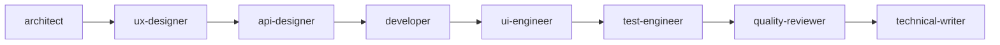

# Claude Code Agents - Complete Summary

## 📊 Overview

**Total Agents:** 11
**Total Size:** ~130KB of comprehensive agent documentation
**Format:** YAML frontmatter + Markdown

## 🎯 Agent Categories

### 🏗️ Architecture & Design (3 agents)

| Agent | Model | Size | Primary Focus |
|-------|-------|------|---------------|
| **architect** | Opus | 5.7KB | System architecture, ADRs, data models |
| **api-designer** | Inherit | 13KB | RESTful API design, OpenAPI specs |
| **ux-designer** | Opus | 20KB | UX/UI design, WCAG accessibility, Nielsen's heuristics |

### 💻 Development & Implementation (2 agents)

| Agent | Model | Size | Primary Focus |
|-------|-------|------|---------------|
| **developer** | Inherit | 7.6KB | Code implementation, zero linting, error handling |
| **ui-engineer** | Inherit | 11KB | Frontend (Next.js/React/Tailwind), bilingual RTL |

### 🔍 Quality Assurance (3 agents)

| Agent | Model | Size | Primary Focus |
|-------|-------|------|---------------|
| **debugger** | Opus | 9.1KB | Systematic bug investigation (min 10 debug statements) |
| **quality-reviewer** | Inherit | 8.8KB | Critical issues review (security, data loss, performance) |
| **test-engineer** | Inherit | 16KB | Test suite generation, coverage |

### 🔒 Security & Performance (2 agents)

| Agent | Model | Size | Primary Focus |
|-------|-------|------|---------------|
| **security-auditor** | Inherit | 11KB | Security vulnerabilities, compliance |
| **performance-optimizer** | Inherit | 9.0KB | Performance analysis, bottleneck optimization |

### 📝 Documentation (1 agent)

| Agent | Model | Size | Primary Focus |
|-------|-------|------|---------------|
| **technical-writer** | Sonnet | 13KB | Documentation creation, API docs, user guides |

## 🚀 Complete Workflow Patterns

### 1. Feature Development Flow


**Steps:**
1. **architect** → Design solution, create ADR
2. **ux-designer** → Design UI/UX (if UI feature)
3. **api-designer** → Design API endpoints (if backend)
4. **developer** → Implement backend
5. **ui-engineer** → Implement frontend
6. **test-engineer** → Create test suite
7. **quality-reviewer** → Review implementation
8. **technical-writer** → Document feature

### 2. Bug Fix Flow
```
debugger → developer → test-engineer → quality-reviewer
```

1. **debugger** → Investigate bug (min 10 debug statements)
2. **developer** → Implement fix
3. **test-engineer** → Add regression tests
4. **quality-reviewer** → Verify no new issues

### 3. Security Review Flow
```
security-auditor → quality-reviewer → developer → security-auditor
```

1. **security-auditor** → Identify vulnerabilities
2. **quality-reviewer** → Verify critical issues
3. **developer** → Implement fixes
4. **security-auditor** → Re-audit and verify

### 4. Performance Optimization Flow
```
performance-optimizer → architect → developer → performance-optimizer → quality-reviewer
```

1. **performance-optimizer** → Profile & identify bottlenecks
2. **architect** → Design strategy (if architectural)
3. **developer** → Implement optimizations
4. **performance-optimizer** → Measure improvements
5. **quality-reviewer** → Ensure no regressions

### 5. Accessibility Audit Flow
```
ux-designer → ui-engineer → test-engineer → ux-designer
```

1. **ux-designer** → Audit WCAG compliance
2. **ui-engineer** → Fix accessibility issues
3. **test-engineer** → Add accessibility tests
4. **ux-designer** → Verify with assistive tech

## 🎨 Agent Specializations

### architect (Opus)
- System design & architecture decisions
- ADR creation
- Data modeling
- Technology stack selection
- Scalability planning

### api-designer
- RESTful resource design
- HTTP methods & status codes
- OpenAPI 3.1 specifications
- Request/response design
- Pagination strategies

### ux-designer (Opus) ⭐
- **Mobile-first design approach (375px baseline)**
- WCAG 2.1 compliance (Level A, AA, AAA)
- Nielsen's 10 usability heuristics
- Inclusive design patterns
- Bilingual RTL/LTR support
- Accessibility testing
- Tailwind CSS mobile-first patterns

### developer
- Precise implementation
- Zero linting violations
- Comprehensive error handling
- Follows project conventions
- Type-safe TypeScript

### ui-engineer
- **Mobile-first with Tailwind CSS (mandatory)**
- Next.js 15 + React 19
- Tailwind CSS breakpoints (base → sm → md → lg → xl)
- shadcn/ui component library
- Bilingual EN/AR with RTL
- Progressive enhancement (375px → desktop)
- Server/Client components

### debugger (Opus)
- Systematic investigation (min 10 debug statements)
- Root cause identification
- Evidence gathering
- Bug categorization
- NEVER implements fixes

### quality-reviewer
- Critical issues only (security, data loss, performance)
- Production impact focus
- Ignores style preferences
- Actionable feedback
- Step-by-step reasoning

### test-engineer
- Unit, integration, E2E tests
- API testing (cURL, Swagger)
- Accessibility testing (@axe-core/react)
- Edge case coverage
- CI/CD integration

### security-auditor
- Vulnerability identification
- OWASP Top 10
- Authentication/authorization audits
- Compliance checking
- PoC exploits

### performance-optimizer
- Bottleneck profiling
- Algorithm optimization
- Caching strategies
- N+1 query detection
- Before/after metrics

### technical-writer (Sonnet)
- API documentation (OpenAPI)
- User guides
- Developer guides
- ADRs
- README files

## 📋 Key Features by Agent

### All Agents Include:
- ✅ Al Ummah Now tech stack context
- ✅ Cloudflare Workers patterns
- ✅ **Mobile-first approach (UX/UI agents)**
- ✅ Tailwind CSS best practices
- ✅ Code examples
- ✅ Checklists
- ✅ Deliverables
- ✅ Best practices

### Technology Context (All Agents):
- **Monorepo:** Turborepo + pnpm
- **Runtime:** Cloudflare Workers
- **Frontend:** Next.js 15 + React 19
- **API:** Hono + chanfana (OpenAPI)
- **Storage:** R2, KV, Durable Objects
- **Auth:** OpenAuth (JWT)
- **CDN:** Bunny.net
- **Bilingual:** EN/AR with RTL

## 🎯 Usage Examples

```bash
# Architecture
@architect Design caching layer for video analytics
@api-designer Design video comments API

# UX/Design
@ux-designer Audit navigation for WCAG compliance
@ui-engineer Build accessible video upload form

# Development
@developer Implement video like endpoint
@ui-engineer Create RTL variant of VideoCard

# Quality
@debugger Investigate WebSocket connection drops
@quality-reviewer Review PR #42 for critical issues
@test-engineer Generate tests for video API

# Security & Performance
@security-auditor Audit authentication flow
@performance-optimizer Optimize video listing query

# Documentation
@technical-writer Document WebSocket API
```

## 📂 File Structure

```
.claude/agents/
├── README.md                    # Agent directory guide (7.0KB)
├── architect.md                 # System architecture (5.7KB)
├── api-designer.md              # API design (13KB)
├── ux-designer.md               # UX/UI & accessibility (20KB) ⭐ NEW
├── developer.md                 # Implementation (7.6KB)
├── ui-engineer.md               # Frontend (11KB)
├── debugger.md                  # Debugging (9.1KB)
├── quality-reviewer.md          # Code quality (8.8KB)
├── test-engineer.md             # Testing (16KB)
├── security-auditor.md          # Security (11KB)
├── performance-optimizer.md     # Performance (9.0KB)
└── technical-writer.md          # Documentation (13KB)
```

## ✨ Highlights

### Most Comprehensive Agents:
1. **ux-designer** (20KB) - Complete WCAG + Nielsen's heuristics
2. **test-engineer** (16KB) - All testing patterns
3. **api-designer** (13KB) - Full OpenAPI patterns
4. **technical-writer** (13KB) - Documentation templates

### Most Specialized:
- **debugger** - ONLY investigates, never fixes
- **quality-reviewer** - ONLY critical issues
- **ux-designer** - WCAG compliance + accessibility

### Model Distribution:
- **Opus (3):** architect, ux-designer, debugger
- **Sonnet (1):** technical-writer
- **Inherit (7):** All others

## 🎓 Best Practices

1. **Use the right agent** - Each has specific expertise
2. **Follow workflows** - Agents work best in sequence
3. **Provide context** - Reference files, PRs, issues
4. **Review outputs** - Agents recommend, you decide
5. **Iterate** - Use multiple agents for complex tasks

## 📊 Coverage

- ✅ Architecture & Design
- ✅ UX/UI & Accessibility
- ✅ API Design
- ✅ Development & Implementation
- ✅ Debugging & Quality
- ✅ Testing & Automation
- ✅ Security & Compliance
- ✅ Performance Optimization
- ✅ Documentation

## 🚀 Quick Start

1. **Invoke agents** with `@agent-name` in Claude Code
2. **Provide context** - files, PRs, issues
3. **Get specialized help** - Each agent's expertise
4. **Follow workflows** - Use agents in sequence
5. **Iterate** - Refine with multiple agents

## 📖 References

- [Claude Code Agents Best Practices](https://superprompt.com/blog/best-claude-code-agents-and-use-cases)
- [Agent Configuration Examples](https://github.com/solatis/claude-config/tree/main/agents)
- [Project Documentation](../CLAUDE.md)
- [WCAG 2.1 Guidelines](https://www.w3.org/WAI/WCAG21/quickref/)
- [Nielsen's Usability Heuristics](https://www.nngroup.com/articles/ten-usability-heuristics/)

---

**Created:** 2025-10-12  
**Total Agents:** 11  
**Total Documentation:** ~130KB  
**Status:** ✅ Production Ready
