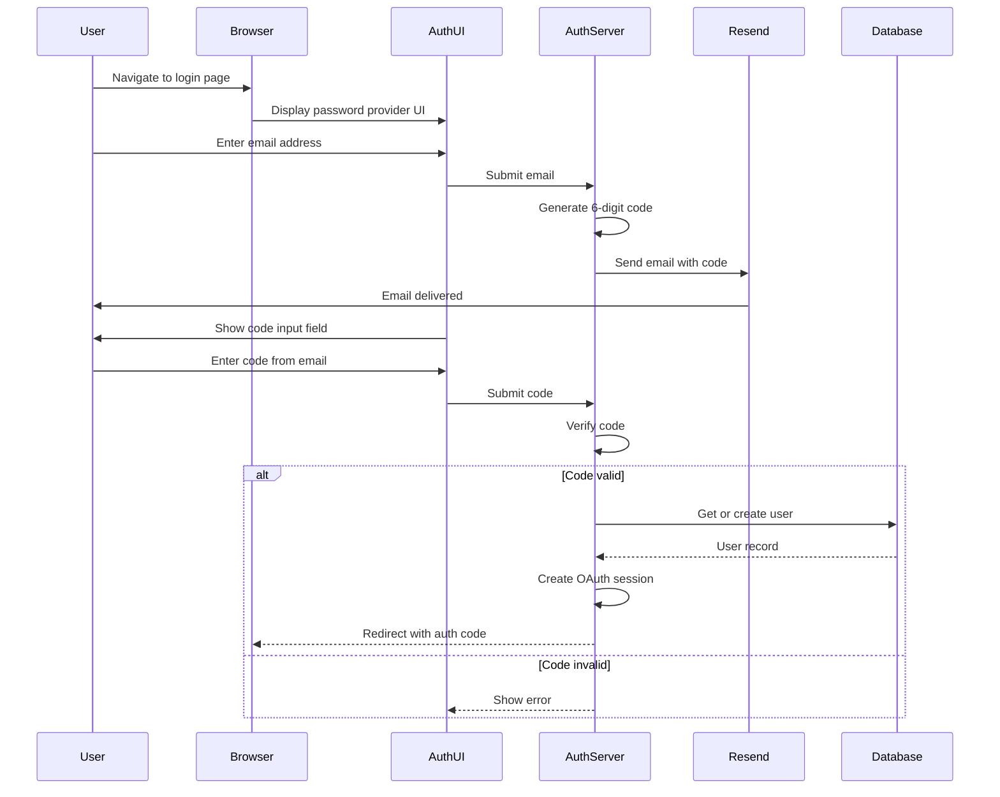
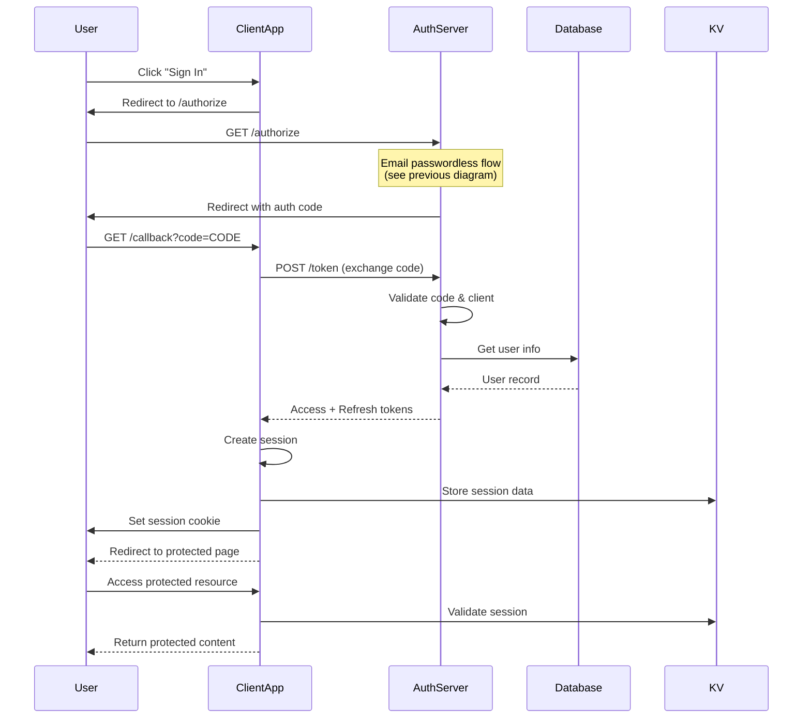
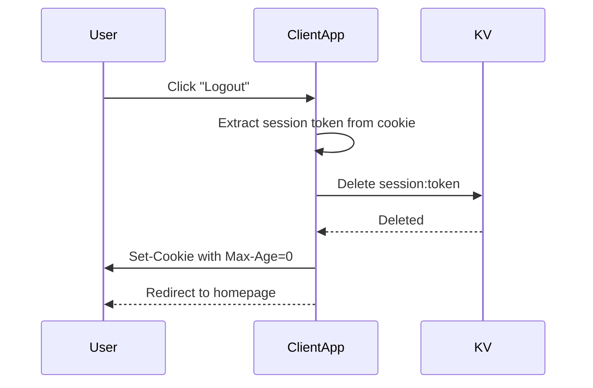

# Authentication Flows

This document provides detailed information about the authentication flows used in the Al Ummah Now system.

## Table of Contents

- [Overview](#overview)
- [Email-Based Passwordless Flow](#email-based-passwordless-flow)
- [OAuth 2.0 Authorization Code Flow](#oauth-20-authorization-code-flow)
- [Token Exchange and Verification](#token-exchange-and-verification)
- [Session Management](#session-management)
- [Logout Flow](#logout-flow)
- [Error Handling](#error-handling)
- [Security Considerations](#security-considerations)

## Overview

The Al Ummah Now authentication system uses a combination of:

1. **Email-based passwordless authentication** - Users authenticate with a code sent to their email
2. **OAuth 2.0 Authorization Code Flow** - Standard OAuth flow for third-party integrations
3. **Session-based authentication** - Sessions stored in KV for authenticated users

### Components

- **Auth Server** (`apps/auth`) - OpenAuth-based OAuth 2.0 provider
- **Profile App** (`apps/profile`) - Example OAuth client application
- **Admin Dashboard** (`apps/admin`) - Administrative interface (also an OAuth client)

## Email-Based Passwordless Flow

The primary authentication method for users. No passwords required - users authenticate using a code sent to their email.

### Flow Diagram



### Step-by-Step Process

#### Step 1: Initiate Login

**User Action:** User navigates to the auth server's login page (via OAuth redirect)

**Request:**
```http
GET /authorize?client_id=profile&redirect_uri=http://localhost:8788/callback&response_type=code&state=random_state
Host: localhost:8787
```

**Response:**
```http
HTTP/1.1 200 OK
Content-Type: text/html

<!-- OpenAuth Password Provider UI -->
<form>
  <input type="email" name="email" placeholder="Email address">
  <button>Continue</button>
</form>
```

#### Step 2: Submit Email

**User Action:** User enters their email address and clicks "Continue"

**Request:**
```http
POST /authorize
Host: localhost:8787
Content-Type: application/x-www-form-urlencoded

email=user@example.com&client_id=profile&redirect_uri=http://localhost:8788/callback
```

**Server Processing:**
1. Validate email format using valibot schema
2. Generate a 6-digit random code
3. Store code in OpenAuth's KV storage (short TTL)
4. Call `sendCode()` handler to send email

**Code Generation:**
```typescript
// OpenAuth handles this internally
const code = Math.floor(100000 + Math.random() * 900000).toString();
// TTL: 5 minutes (typical)
```

**Email Sent:**
```
From: login@alummahnow.net
To: user@example.com
Subject: Your login code

Your login code is 123456

This code expires in 5 minutes.
```

**Response:**
```http
HTTP/1.1 200 OK
Content-Type: text/html

<!-- Show code input field -->
<form>
  <input type="text" name="code" placeholder="Code (check your inbox)">
  <button>Verify</button>
</form>
```

#### Step 3: Submit Code

**User Action:** User checks email, enters the code, and clicks "Verify"

**Request:**
```http
POST /authorize
Host: localhost:8787
Content-Type: application/x-www-form-urlencoded

code=123456&email=user@example.com&client_id=profile&redirect_uri=http://localhost:8788/callback
```

**Server Processing:**
1. Verify code matches the stored code for the email
2. Call `success()` handler with email
3. Check if user exists in database
4. Create user if new, or return existing user
5. Generate OAuth authorization code
6. Redirect to client with authorization code

**User Creation/Retrieval:**
```typescript
// apps/auth/src/users.ts
export async function getOrCreateUser(env: Env, email: string) {
  // Check if user exists
  const existingUser = await env.AUTH_DB.prepare(
    'SELECT id, role FROM user WHERE email = ?'
  ).bind(email).first();

  if (existingUser) {
    return existingUser;
  }

  // Create new user with 'user' role
  const result = await env.AUTH_DB.prepare(
    'INSERT INTO user (email, role, password_reset_required) VALUES (?, "user", FALSE) RETURNING id, role'
  ).bind(email).first();

  return result;
}
```

**Response:**
```http
HTTP/1.1 302 Found
Location: http://localhost:8788/callback?code=AUTH_CODE_HERE&state=random_state
```

### Rate Limiting

The auth server implements rate limiting on authentication attempts:

- **Rate Limit:** 5 attempts per IP per minute
- **Window:** 60 seconds sliding window
- **Response on exceed:** HTTP 429 Too Many Requests

```typescript
// Rate limit check before code verification
const clientIP = getClientIP(request);
const allowed = await checkRateLimit(env.AUTH_DB, clientIP, 'auth:code_verify', 5, 60);

if (!allowed) {
  return new Response('Too many attempts. Please try again later.', {
    status: 429,
    headers: { 'Retry-After': '60' }
  });
}
```

## OAuth 2.0 Authorization Code Flow

Standard OAuth 2.0 flow used by client applications (Profile App, Admin Dashboard) to authenticate users.

### Flow Diagram



### Authorization Request

**Step 1: Client redirects user to authorization endpoint**

```typescript
// Client app initiates OAuth flow
const authUrl = new URL('http://localhost:8787/authorize');
authUrl.searchParams.set('client_id', 'profile');
authUrl.searchParams.set('redirect_uri', 'http://localhost:8788/callback');
authUrl.searchParams.set('response_type', 'code');
authUrl.searchParams.set('state', generateRandomState()); // CSRF protection

// Redirect user
window.location.href = authUrl.toString();
```

**Request:**
```http
GET /authorize?client_id=profile&redirect_uri=http://localhost:8788/callback&response_type=code&state=xyz123 HTTP/1.1
Host: localhost:8787
```

**Parameters:**
- `client_id` (required) - Client application identifier
- `redirect_uri` (required) - Where to redirect after authentication
- `response_type` (required) - Must be "code" for authorization code flow
- `state` (recommended) - Random value for CSRF protection

### Authorization Response

After user completes email authentication:

```http
HTTP/1.1 302 Found
Location: http://localhost:8788/callback?code=eyJhbGc...&state=xyz123
```

**Parameters:**
- `code` - Authorization code (short-lived, single-use)
- `state` - Same value sent in request (client must verify)

**Error Response:**
```http
HTTP/1.1 302 Found
Location: http://localhost:8788/callback?error=access_denied&error_description=User+denied+access&state=xyz123
```

## Token Exchange and Verification

After receiving the authorization code, the client exchanges it for access and refresh tokens.

### Token Exchange Request

```typescript
// Client app exchanges code for tokens
const response = await fetch('http://localhost:8787/token', {
  method: 'POST',
  headers: {
    'Content-Type': 'application/x-www-form-urlencoded',
  },
  body: new URLSearchParams({
    grant_type: 'authorization_code',
    code: authorizationCode,
    redirect_uri: 'http://localhost:8788/callback',
    client_id: 'profile',
  }),
});

const tokens = await response.json();
```

**Request:**
```http
POST /token HTTP/1.1
Host: localhost:8787
Content-Type: application/x-www-form-urlencoded

grant_type=authorization_code&code=AUTH_CODE&redirect_uri=http://localhost:8788/callback&client_id=profile
```

**Parameters:**
- `grant_type` (required) - Must be "authorization_code"
- `code` (required) - Authorization code from previous step
- `redirect_uri` (required) - Must match the original redirect_uri
- `client_id` (required) - Client identifier

### Token Response

**Success:**
```http
HTTP/1.1 200 OK
Content-Type: application/json

{
  "access_token": "eyJhbGciOiJIUzI1NiIsInR5cCI6IkpXVCJ9...",
  "refresh_token": "eyJhbGciOiJIUzI1NiIsInR5cCI6IkpXVCJ9...",
  "token_type": "Bearer",
  "expires_in": 3600
}
```

**Token Structure (JWT):**
```json
{
  "header": {
    "alg": "HS256",
    "typ": "JWT"
  },
  "payload": {
    "sub": "user-id-here",
    "type": "access",
    "properties": {
      "id": "user-id-here",
      "email": "user@example.com",
      "role": "user"
    },
    "iss": "http://localhost:8787",
    "aud": "profile",
    "exp": 1704067200,
    "iat": 1704063600
  }
}
```

**Error Response:**
```http
HTTP/1.1 400 Bad Request
Content-Type: application/json

{
  "error": "invalid_grant",
  "error_description": "Authorization code has expired"
}
```

**Common Error Codes:**
- `invalid_grant` - Code expired, already used, or invalid
- `invalid_client` - Unknown client_id
- `invalid_request` - Missing required parameters
- `unauthorized_client` - Client not authorized for this grant type

### Token Verification

Clients verify access tokens on each request:

```typescript
import { createClient } from '@openauthjs/openauth/client';

const client = createClient({
  issuer: 'http://localhost:8787',
  clientId: 'profile',
});

// Verify token
const verified = await client.verify(subjects, accessToken);

if (verified.err) {
  // Token invalid
  console.error('Token verification failed:', verified.err);
  return Response.redirect('/login');
}

// Token valid - extract user info
const { subject } = verified;
const userId = subject.properties.id;
const userEmail = subject.properties.email;
const userRole = subject.properties.role;
```

### Refresh Token Flow

When access token expires, use refresh token to get new tokens:

```typescript
const response = await fetch('http://localhost:8787/token', {
  method: 'POST',
  headers: {
    'Content-Type': 'application/x-www-form-urlencoded',
  },
  body: new URLSearchParams({
    grant_type: 'refresh_token',
    refresh_token: refreshToken,
    client_id: 'profile',
  }),
});

const newTokens = await response.json();
```

**Request:**
```http
POST /token HTTP/1.1
Host: localhost:8787
Content-Type: application/x-www-form-urlencoded

grant_type=refresh_token&refresh_token=REFRESH_TOKEN&client_id=profile
```

**Response:**
```json
{
  "access_token": "new_access_token",
  "refresh_token": "new_refresh_token",
  "token_type": "Bearer",
  "expires_in": 3600
}
```

## Session Management

After successful authentication, client applications create sessions to avoid repeated OAuth flows.

### Session Creation

```typescript
// apps/profile/src/session.ts
import { createSession, createSessionCookie } from './session';

// After token exchange
const sessionData = {
  user: {
    id: verified.subject.properties.id,
    email: verified.subject.properties.email,
    role: verified.subject.properties.role,
  },
  tokens: {
    access: tokens.access_token,
    refresh: tokens.refresh_token,
  },
  expiresAt: new Date(Date.now() + 7 * 24 * 60 * 60 * 1000).toISOString(), // 7 days
};

// Store in KV
const sessionToken = await createSession(env.PROFILE_STORAGE, sessionData);

// Set cookie
const isLocalhost = url.hostname === 'localhost';
const cookie = createSessionCookie(sessionToken, isLocalhost);

return new Response(null, {
  status: 302,
  headers: {
    'Location': '/profile',
    'Set-Cookie': cookie,
  },
});
```

### Session Structure

**KV Storage:**
```
Key: session:{uuid}
Value: {
  "user": {
    "id": "user-id-here",
    "email": "user@example.com",
    "role": "user"
  },
  "tokens": {
    "access": "access_token_here",
    "refresh": "refresh_token_here"
  },
  "expiresAt": "2025-10-19T12:00:00.000Z"
}
TTL: 7 days (604800 seconds)
```

**Cookie:**
```
Set-Cookie: profile_session=uuid-here; Path=/; HttpOnly; Secure; SameSite=Lax; Max-Age=604800
```

**Cookie Attributes:**
- `HttpOnly` - Prevents JavaScript access (XSS protection)
- `Secure` - HTTPS only (omitted in localhost)
- `SameSite=Lax` - CSRF protection while allowing OAuth redirects
- `Max-Age=604800` - 7 days (same as KV TTL)

### Session Validation

```typescript
// Middleware for protected routes
export async function requireAuth(request: Request, env: Env) {
  const session = await getUserSession(request, env.PROFILE_STORAGE);

  if (!session) {
    // No session - redirect to login
    return Response.redirect('/login');
  }

  // Check if session expired
  if (new Date(session.expiresAt) < new Date()) {
    // Session expired - delete and redirect
    await deleteSession(request, env.PROFILE_STORAGE);
    return Response.redirect('/login');
  }

  // Session valid - verify access token
  const verified = await client.verify(subjects, session.tokens.access);

  if (verified.err) {
    // Token invalid - try refresh
    const newTokens = await refreshAccessToken(session.tokens.refresh);

    if (newTokens) {
      // Update session with new tokens
      session.tokens = newTokens;
      await updateSession(request, env.PROFILE_STORAGE, session);
    } else {
      // Refresh failed - redirect to login
      await deleteSession(request, env.PROFILE_STORAGE);
      return Response.redirect('/login');
    }
  }

  return session;
}
```

## Logout Flow

Logout clears the session and redirects the user to the homepage.

### Logout Diagram



### Logout Implementation

```typescript
// apps/profile/src/index.ts
if (url.pathname === '/logout') {
  // Delete session from KV
  await deleteSession(request, env.PROFILE_STORAGE);

  // Redirect with cleared cookie
  const isLocalhost = url.hostname === 'localhost';
  return new Response(null, {
    status: 302,
    headers: {
      'Location': '/',
      'Set-Cookie': clearSessionCookie(isLocalhost),
    },
  });
}
```

### Session Deletion

```typescript
// apps/profile/src/session.ts
export async function deleteSession(
  request: Request,
  storage: KVNamespace
): Promise<void> {
  const sessionToken = getSessionTokenFromCookie(request);
  if (!sessionToken) return;

  await storage.delete(`session:${sessionToken}`);
}

export function clearSessionCookie(isLocalhost: boolean = false): string {
  const secureFlag = isLocalhost ? '' : 'Secure; ';
  return `profile_session=; Path=/; HttpOnly; ${secureFlag}SameSite=Lax; Max-Age=0`;
}
```

## Error Handling

Comprehensive error handling for authentication flows.

### Common Error Scenarios

#### Invalid Email Format

**Trigger:** User submits malformed email address

**Handling:**
```typescript
import * as v from 'valibot';

const EmailSchema = v.pipe(v.string(), v.email());

try {
  v.parse(EmailSchema, email);
} catch (error) {
  return new Response('Invalid email address', { status: 400 });
}
```

**User Experience:** Show inline error message: "Please enter a valid email address"

#### Code Expired

**Trigger:** User submits code after 5-minute expiration

**Response:**
```http
HTTP/1.1 400 Bad Request
Content-Type: text/html

<!-- OpenAuth UI shows error -->
<div class="error">
  This code has expired. Please request a new code.
</div>
```

**User Action:** Request new code by re-entering email

#### Invalid Code

**Trigger:** User submits incorrect code

**Response:**
```http
HTTP/1.1 400 Bad Request
Content-Type: text/html

<div class="error">
  Invalid code. Please check your email and try again.
</div>
```

**Security:** After 3 failed attempts, require new code request

#### Email Sending Failed

**Trigger:** Resend API error or network issue

**Handling:**
```typescript
try {
  await SendEmail(apiKey, from, to, subject, html);
} catch (error) {
  logger.error('Failed to send login code', { email, error });

  // Return error to user
  return new Response('Unable to send email. Please try again.', {
    status: 500
  });
}
```

**Retry Logic:** Email sending has automatic retry (3 attempts with exponential backoff)

#### Authorization Code Expired

**Trigger:** Client exchanges code after 10-minute expiration

**Response:**
```json
{
  "error": "invalid_grant",
  "error_description": "Authorization code has expired"
}
```

**Client Handling:** Restart OAuth flow from beginning

#### Invalid Redirect URI

**Trigger:** redirect_uri in token request doesn't match authorization request

**Response:**
```json
{
  "error": "invalid_request",
  "error_description": "Invalid redirect_uri"
}
```

**Security:** Prevents authorization code interception attacks

#### Token Verification Failed

**Trigger:** Invalid, expired, or tampered token

**Response:**
```typescript
const verified = await client.verify(subjects, accessToken);

if (verified.err) {
  if (verified.err === 'TOKEN_EXPIRED') {
    // Try refresh token
    return await refreshAccessToken(refreshToken);
  }

  // Invalid token - logout
  return Response.redirect('/logout');
}
```

#### Rate Limit Exceeded

**Trigger:** Too many authentication attempts from same IP

**Response:**
```http
HTTP/1.1 429 Too Many Requests
Retry-After: 60
Content-Type: application/json

{
  "error": "rate_limit_exceeded",
  "message": "Too many attempts. Please try again later."
}
```

**Rate Limits:**
- Code verification: 5 attempts per minute per IP
- Token exchange: 10 requests per minute per IP

### Error Logging

All errors are logged to D1 database:

```typescript
logger.error('Authentication failed', {
  email: userEmail,
  error: error.message,
  clientIP: getClientIP(request),
  timestamp: new Date().toISOString(),
});
```

View logs at: `http://localhost:8787/logs`

## Security Considerations

### CSRF Protection

**State Parameter:**
- Client generates random state value
- State included in authorization request
- State verified in callback
- Prevents authorization code injection

```typescript
// Generate state
const state = crypto.randomUUID();
sessionStorage.setItem('oauth_state', state);

// Verify state
const receivedState = url.searchParams.get('state');
const savedState = sessionStorage.getItem('oauth_state');

if (receivedState !== savedState) {
  throw new Error('Invalid state - possible CSRF attack');
}
```

### Code Replay Prevention

- Authorization codes are single-use
- Attempting to reuse a code invalidates all associated tokens
- Codes expire after 10 minutes

### Token Security

**Access Tokens:**
- Short-lived (1 hour)
- JWT format with signature verification
- Include audience claim (client_id)

**Refresh Tokens:**
- Longer-lived (30 days)
- Rotate on each use (planned enhancement)
- Revoked on logout

### Session Security

**Cookie Security:**
- HttpOnly prevents XSS attacks
- Secure flag enforces HTTPS (production)
- SameSite=Lax prevents CSRF while allowing OAuth

**Session Storage:**
- Encrypted at rest in KV
- Automatic expiration (7 days)
- Deleted on explicit logout

### Rate Limiting

Protects against brute force attacks:

- Code verification: 5 attempts/minute
- Token exchange: 10 requests/minute
- Implemented per-IP using D1 database

### Email Security

- Email addresses validated with valibot
- From address verified (SPF/DKIM via Resend)
- Codes are 6 digits (1 million combinations)
- Codes expire after 5 minutes

### TLS/HTTPS

- All production traffic over HTTPS
- Cloudflare provides TLS termination
- HSTS header enforces HTTPS

## Integration Examples

### Profile App Integration

```typescript
// apps/profile/src/index.ts
import { createClient } from '@openauthjs/openauth/client';

const client = createClient({
  issuer: env.AUTH_SERVER_URL,
  clientId: 'profile',
});

// Login handler
if (url.pathname === '/login') {
  const authUrl = new URL(`${env.AUTH_SERVER_URL}/authorize`);
  authUrl.searchParams.set('client_id', 'profile');
  authUrl.searchParams.set('redirect_uri', `${url.origin}/callback`);
  authUrl.searchParams.set('response_type', 'code');

  return Response.redirect(authUrl.toString());
}

// Callback handler
if (url.pathname === '/callback') {
  const code = url.searchParams.get('code');

  // Exchange code for tokens
  const tokens = await client.exchange({
    code,
    redirect_uri: `${url.origin}/callback`,
  });

  // Create session
  const sessionToken = await createSession(env.PROFILE_STORAGE, {
    user: tokens.subject.properties,
    tokens: {
      access: tokens.access,
      refresh: tokens.refresh,
    },
    expiresAt: new Date(Date.now() + 7 * 24 * 60 * 60 * 1000).toISOString(),
  });

  // Set cookie and redirect
  return new Response(null, {
    status: 302,
    headers: {
      'Location': '/profile',
      'Set-Cookie': createSessionCookie(sessionToken),
    },
  });
}
```

### Admin Dashboard Integration

```typescript
// Similar to profile app, but with role check
const session = await requireAuth(request, env);

if (session.user.role !== 'admin') {
  return new Response('Forbidden: Admin access required', {
    status: 403
  });
}
```

## Troubleshooting

### Issue: 522 Timeout in Production

**Cause:** Auth server trying to make HTTP request to itself

**Solution:** Use separate client app (Profile App) instead of auth server's landing page

### Issue: Email Not Received

**Possible Causes:**
1. RESEND_API_KEY not configured
2. Email in spam folder
3. Invalid email address
4. Resend API rate limit

**Debug:**
1. Check logs: `http://localhost:8787/logs`
2. Verify RESEND_API_KEY in wrangler.json
3. Check Resend dashboard for delivery status

### Issue: Session Not Persisting

**Possible Causes:**
1. Cookie not set correctly
2. KV namespace not bound
3. Session expired
4. Browser blocking cookies

**Debug:**
1. Check browser DevTools > Application > Cookies
2. Verify KV binding in wrangler.json
3. Check session expiration date
4. Test in incognito mode

### Issue: Token Verification Failed

**Possible Causes:**
1. Token expired
2. Invalid issuer URL
3. Client ID mismatch
4. Token tampered with

**Debug:**
1. Decode JWT at jwt.io
2. Verify `iss` claim matches AUTH_SERVER_URL
3. Verify `aud` claim matches client_id
4. Check `exp` claim (expiration)

---

**Last Updated:** October 12, 2025

For more information, see:
- [ARCHITECTURE.md](./ARCHITECTURE.md) - System architecture
- [SECURITY.md](./SECURITY.md) - Security policy
- [apps/auth/README.md](./apps/auth/README.md) - Auth server documentation
