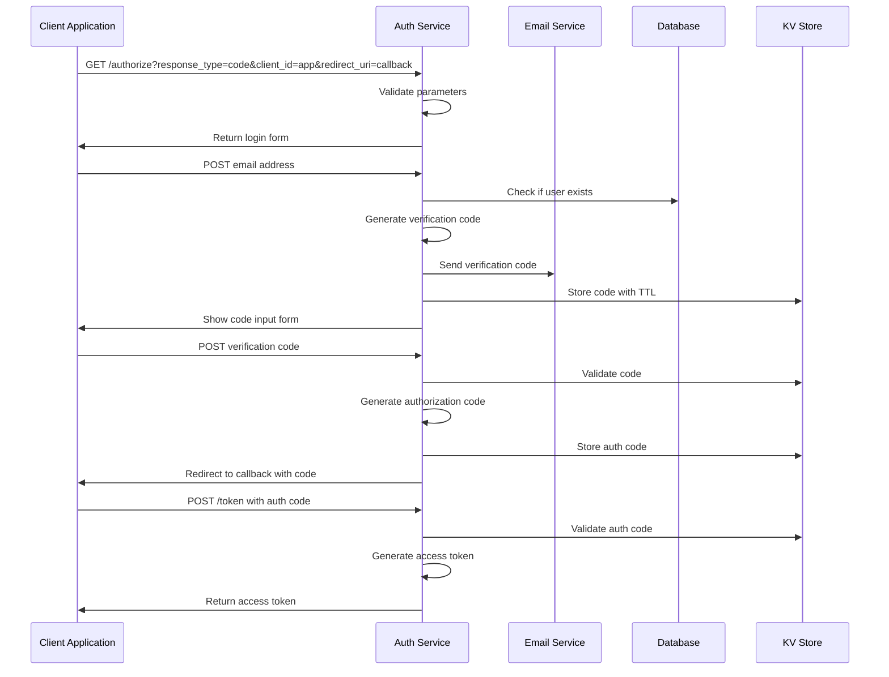
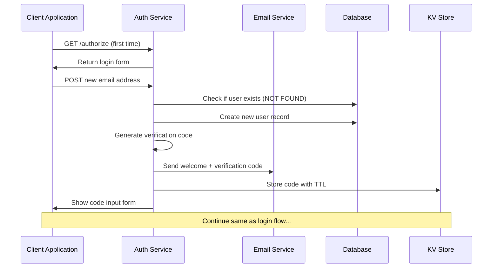
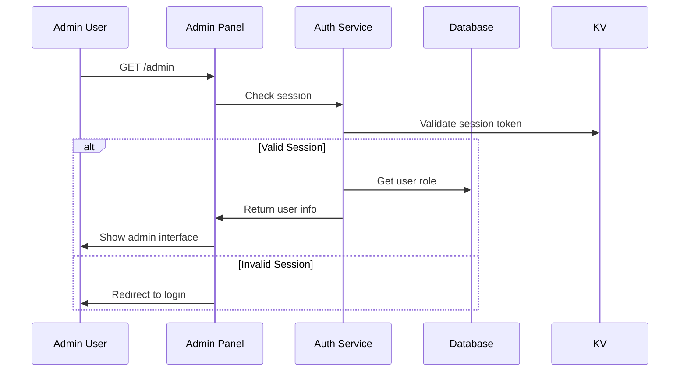
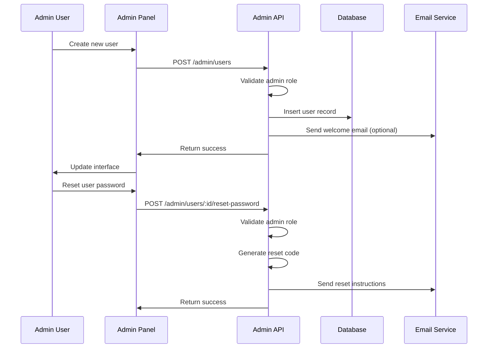

# Al Ummah Now Auth - Authentication Flows Documentation

This document provides detailed technical documentation of all authentication flows supported by the Al Ummah Now Authentication service.

## 🔐 Overview

The Al Ummah Now Auth service implements secure, email-based authentication using the OpenAuth framework. All flows are designed with security-first principles and follow OAuth 2.0 / OpenID Connect standards.

## 🔄 Core Authentication Flows

### 1. Email-Based Authentication Flow

#### Standard User Login


#### New User Registration


### 2. Admin Authentication Flow

#### Admin Panel Access


#### Admin User Management


## 🔑 Token Management

### Access Token Flow
```javascript
// Token validation example
async function validateToken(token) {
  try {
    const session = await KV.get(`session:${token}`);
    if (!session) {
      throw new Error('Invalid token');
    }
    
    const sessionData = JSON.parse(session);
    if (sessionData.expires < Date.now()) {
      await KV.delete(`session:${token}`);
      throw new Error('Token expired');
    }
    
    return sessionData.user;
  } catch (error) {
    throw new Error('Token validation failed');
  }
}
```

### Session Management
```javascript
// Session creation
async function createSession(userId) {
  const token = generateSecureToken();
  const session = {
    userId,
    created: Date.now(),
    expires: Date.now() + (24 * 60 * 60 * 1000), // 24 hours
    lastAccess: Date.now()
  };
  
  await KV.put(`session:${token}`, JSON.stringify(session), {
    expirationTtl: 24 * 60 * 60 // 24 hours
  });
  
  return token;
}
```

## 📧 Email Verification Process

### Code Generation & Validation
```javascript
// Generate verification code
function generateVerificationCode() {
  return Math.random().toString(36).substring(2, 8).toUpperCase();
}

// Store verification code
async function storeVerificationCode(email, code) {
  await KV.put(`verify:${email}`, code, {
    expirationTtl: 10 * 60 // 10 minutes
  });
}

// Validate verification code
async function validateVerificationCode(email, providedCode) {
  const storedCode = await KV.get(`verify:${email}`);
  if (!storedCode || storedCode !== providedCode) {
    throw new Error('Invalid verification code');
  }
  
  // Clean up used code
  await KV.delete(`verify:${email}`);
  return true;
}
```

### Email Templates
```javascript
// Login code email
const loginEmailTemplate = (code) => `
Subject: Your Al Ummah Now Login Code

Assalamu Alaikum,

Your login code for Al Ummah Now is: ${code}

This code will expire in 10 minutes for your security.

If you didn't request this code, please ignore this email.

Barakallahu feek,
Al Ummah Now Team
`;

// Welcome email for new users
const welcomeEmailTemplate = (code) => `
Subject: Welcome to Al Ummah Now

Assalamu Alaikum and welcome to Al Ummah Now!

To complete your registration, please use this verification code: ${code}

This code will expire in 10 minutes.

We're excited to have you join our community.

Barakallahu feek,
Al Ummah Now Team
`;
```

## 🛡️ Security Measures

### Rate Limiting
```javascript
// Email rate limiting (prevent spam)
async function checkEmailRateLimit(email) {
  const key = `rate:email:${email}`;
  const current = await KV.get(key);
  
  if (current && parseInt(current) >= 3) {
    throw new Error('Too many email requests. Please wait 15 minutes.');
  }
  
  const newCount = current ? parseInt(current) + 1 : 1;
  await KV.put(key, newCount.toString(), {
    expirationTtl: 15 * 60 // 15 minutes
  });
}

// Login attempt rate limiting
async function checkLoginRateLimit(ip) {
  const key = `rate:login:${ip}`;
  const current = await KV.get(key);
  
  if (current && parseInt(current) >= 10) {
    throw new Error('Too many login attempts. Please wait 1 hour.');
  }
  
  const newCount = current ? parseInt(current) + 1 : 1;
  await KV.put(key, newCount.toString(), {
    expirationTtl: 60 * 60 // 1 hour
  });
}
```

### Code Security
```javascript
// Secure code generation
function generateSecureCode() {
  const chars = '0123456789ABCDEFGHIJKLMNOPQRSTUVWXYZ';
  let result = '';
  const array = new Uint8Array(6);
  crypto.getRandomValues(array);
  
  for (let i = 0; i < 6; i++) {
    result += chars[array[i] % chars.length];
  }
  
  return result;
}

// Token generation with cryptographic randomness
function generateSecureToken() {
  const array = new Uint8Array(32);
  crypto.getRandomValues(array);
  return Array.from(array, byte => byte.toString(16).padStart(2, '0')).join('');
}
```

## 🔧 Error Handling

### Authentication Errors
```javascript
class AuthenticationError extends Error {
  constructor(message, code) {
    super(message);
    this.name = 'AuthenticationError';
    this.code = code;
  }
}

// Error codes and handling
const ErrorCodes = {
  INVALID_EMAIL: 'INVALID_EMAIL',
  INVALID_CODE: 'INVALID_CODE',
  EXPIRED_CODE: 'EXPIRED_CODE',
  RATE_LIMITED: 'RATE_LIMITED',
  USER_NOT_FOUND: 'USER_NOT_FOUND',
  UNAUTHORIZED: 'UNAUTHORIZED'
};

async function handleAuthError(error, request) {
  console.error('Authentication error:', error);
  
  switch (error.code) {
    case ErrorCodes.RATE_LIMITED:
      return new Response('Rate limit exceeded', { status: 429 });
    case ErrorCodes.UNAUTHORIZED:
      return new Response('Unauthorized', { status: 401 });
    case ErrorCodes.INVALID_CODE:
      return new Response('Invalid verification code', { status: 400 });
    default:
      return new Response('Authentication failed', { status: 500 });
  }
}
```

## 📱 Client Integration Examples

### Web Application Integration
```javascript
// Redirect to authentication
function initiateLogin() {
  const params = new URLSearchParams({
    response_type: 'code',
    client_id: 'web-app',
    redirect_uri: window.location.origin + '/auth/callback',
    scope: 'openid email profile'
  });
  
  window.location.href = `https://auth.alummahnow.net/authorize?${params}`;
}

// Handle callback
async function handleAuthCallback() {
  const params = new URLSearchParams(window.location.search);
  const code = params.get('code');
  
  if (!code) {
    throw new Error('Authorization code not received');
  }
  
  const response = await fetch('https://auth.alummahnow.net/token', {
    method: 'POST',
    headers: {
      'Content-Type': 'application/x-www-form-urlencoded',
    },
    body: new URLSearchParams({
      grant_type: 'authorization_code',
      code: code,
      client_id: 'web-app',
      redirect_uri: window.location.origin + '/auth/callback'
    })
  });
  
  const tokens = await response.json();
  localStorage.setItem('access_token', tokens.access_token);
  
  // Redirect to application
  window.location.href = '/dashboard';
}
```

### API Integration
```javascript
// Protected API request
async function makeAuthenticatedRequest(url, options = {}) {
  const token = localStorage.getItem('access_token');
  
  const response = await fetch(url, {
    ...options,
    headers: {
      ...options.headers,
      'Authorization': `Bearer ${token}`
    }
  });
  
  if (response.status === 401) {
    // Token expired, redirect to login
    initiateLogin();
    return;
  }
  
  return response;
}
```

## 🔍 Debugging & Troubleshooting

### Common Issues

#### 1. Email Not Received
**Symptoms**: User doesn't receive verification code  
**Debugging**:
```javascript
// Check email service logs
console.log('Email sending attempt:', { email, code, timestamp: Date.now() });

// Verify Resend API key
const apiKey = await env.RESEND_API_KEY.get();
if (!apiKey) {
  console.error('RESEND_API_KEY not configured');
}
```

#### 2. Code Validation Failures
**Symptoms**: Valid codes rejected  
**Debugging**:
```javascript
// Log code storage and retrieval
console.log('Storing code:', { email, code, ttl: 600 });
const storedCode = await KV.get(`verify:${email}`);
console.log('Retrieved code:', { email, storedCode, providedCode });
```

#### 3. Session Issues
**Symptoms**: Users logged out unexpectedly  
**Debugging**:
```javascript
// Check session storage
const sessionData = await KV.get(`session:${token}`);
console.log('Session data:', sessionData);

// Verify TTL settings
const ttl = await KV.getWithMetadata(`session:${token}`);
console.log('Session TTL:', ttl.metadata);
```

### Performance Monitoring
```javascript
// Track authentication flow performance
async function trackAuthFlow(step, startTime) {
  const duration = Date.now() - startTime;
  console.log(`Auth flow step: ${step}, duration: ${duration}ms`);
  
  // Store metrics in KV for analysis
  await KV.put(`metrics:auth:${step}:${Date.now()}`, duration.toString(), {
    expirationTtl: 24 * 60 * 60 // 24 hours
  });
}
```

## 📋 Testing Flows

### Manual Testing Checklist
- [ ] **New User Registration**
  - Email verification code received
  - Code validation works
  - User created in database
  - Successful redirect to application

- [ ] **Existing User Login**
  - Login form displays correctly
  - Verification code sent
  - Code validation successful
  - Session created properly

- [ ] **Admin Panel Access**
  - Admin role validation
  - User management functions
  - Password reset functionality

- [ ] **Error Scenarios**
  - Invalid email format
  - Expired verification codes
  - Rate limiting enforcement
  - Network failure handling

### Automated Testing
```javascript
// Example test case
describe('Authentication Flow', () => {
  test('should complete email verification flow', async () => {
    const email = 'test@example.com';
    
    // Step 1: Initiate authentication
    const authResponse = await fetch('/authorize', {
      method: 'POST',
      body: JSON.stringify({ email }),
      headers: { 'Content-Type': 'application/json' }
    });
    
    expect(authResponse.status).toBe(200);
    
    // Step 2: Verify code (mock)
    const mockCode = '123456';
    const verifyResponse = await fetch('/verify', {
      method: 'POST',
      body: JSON.stringify({ email, code: mockCode }),
      headers: { 'Content-Type': 'application/json' }
    });
    
    expect(verifyResponse.status).toBe(200);
  });
});
```

---

*This authentication flows documentation is updated with each release and covers all supported authentication patterns.*

## Related Documentation

- [Roadmap](./ROADMAP.md)
- [Architecture Documentation](./ARCHITECTURE.md)
- [User Management Guide](./USER_MANAGEMENT.md)
- [CI/CD Documentation](./CICD.md)