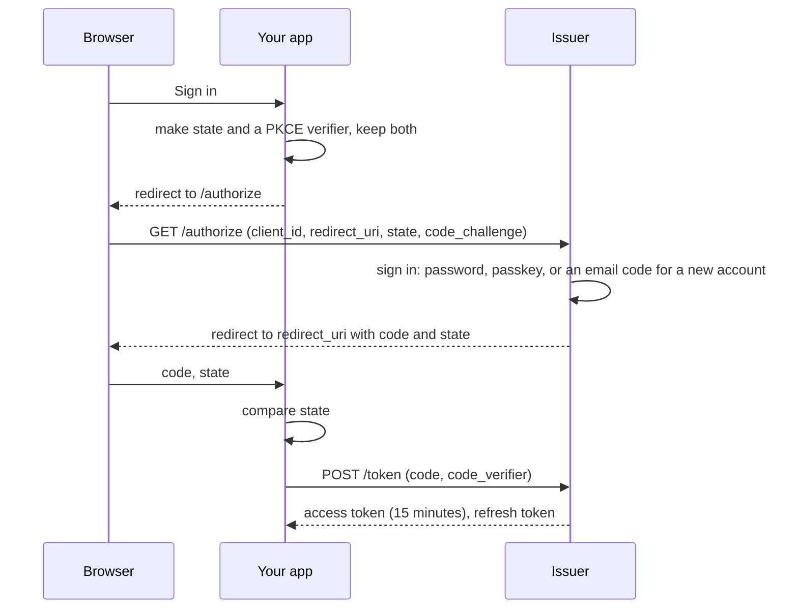

# Sign-in flows

Every app signs in through one issuer. Pick the flow by what your app is:

| Your app | Flow | Client |
|---|---|---|
| A website or browser app | [Authorization code with PKCE](#web) | Public, or confidential when it has a server |
| A phone or desktop app | [The same, in the system browser](#native), or a native passkey | Public |
| A TV | [Device code](#tv) | Public |
| A server with no user | [Client credentials](#server) | Confidential |

## Web

- `redirect_uri` must be registered, and match exactly.
- PKCE is `S256` only. Public clients must use it, and so must every first-party web client.
- A code lives 10 minutes and works once. Using it again revokes the tokens it was exchanged for.
- **Single sign-on:** a browser already signed in comes straight back. `prompt=login` asks for a fresh sign-in, `prompt=select_account` shows the account picker, `prompt=none` never shows a page and fails with `login_required`.
- The pages are in English unless the URL has `lang=ar`.

## Native

The system browser, never a web view. Register a private-use scheme (`alummahnow-studio://auth/callback`) or, on desktop, a loopback redirect. Otherwise as on the web, with one addition: send `install_id` at `POST /token`, an id your app makes once per install, so staff can sign out one lost device.

Studio and Admin can also sign in with the platform's passkey sheet, with no browser:

1. `POST /native/passkey/options` with the client id and a PKCE challenge answers a challenge.
2. The platform's passkey API signs it.
3. `POST /native/passkey/verify` answers a code, exchanged at `POST /token` as usual.

## TV

1. `POST /device_authorization` answers a `user_code` and an address to show, and a secret `device_code`.
2. The user opens the address on their phone, types the code and approves.
3. The TV polls `POST /token` every `interval` seconds: `authorization_pending` until then, `slow_down` means 5 seconds longer from now on, then the tokens, or `access_denied` or `expired_token`. Codes live 10 minutes.

## Server

`POST /token` with `grant_type=client_credentials` and HTTP Basic. The token is for the client itself and has no refresh token: ask again when it is about to expire, not for each request. A few APIs ([invites](docs/USER_INVITES.md), [moderation](docs/MODERATION_REQUESTS.md), [revocations](docs/TOKEN_REVOCATIONS.md)) take HTTP Basic directly, for a client registered with their scope.

## Tokens

**Access token:** a JWT signed with ES256, 15 minutes. Verify the signature with the keys at `/.well-known/jwks.json` by `kid`, and check `iss`, `exp`, `aud` (your client id) and `mode: "access"`. The user is in `properties`: `id` (key your data by it), `email`, `roles`. `auth_time` and `amr` say when and how they signed in, and `sid` names the sign-in.

**Refresh token:** opaque, 30 days from its last use. Every refresh answers a new one; store it before using the access token. An old one stays usable for two minutes, for a race between tabs, and after that using it revokes the whole family.

**Keys** rotate on a schedule. A new key is published before it signs ([docs/SIGNING_KEY_ROTATION.md](docs/SIGNING_KEY_ROTATION.md)). On an unknown `kid`, read the keys again, at most every 30 seconds.

**Revocation:** suspending or deleting an account, a password change and "sign out of all devices" end every sign-in at once. Refresh tokens are refused, and services that read the revocation list refuse access tokens too ([docs/TOKEN_REVOCATIONS.md](docs/TOKEN_REVOCATIONS.md)). Services that don't, within 15 minutes.

## Signing out

Clear your own session, then send the browser to `GET /logout?return=<your page>`. The issuer ends the shared session, visits each of our apps' sign-out address, and comes back. A request that didn't come from one of our apps is asked to confirm first. To end one sign-in without a browser, `POST /token/revoke` its refresh token.

## Roles

Site roles are in the token and re-read at each refresh. Channel roles are not: they live in the videos service. Staff actions on an account also need a recent sign-in; `DELETE /account` answers `401 insufficient_user_authentication` when `auth_time` is more than 10 minutes old, and the app signs in again with `prompt=login`.
