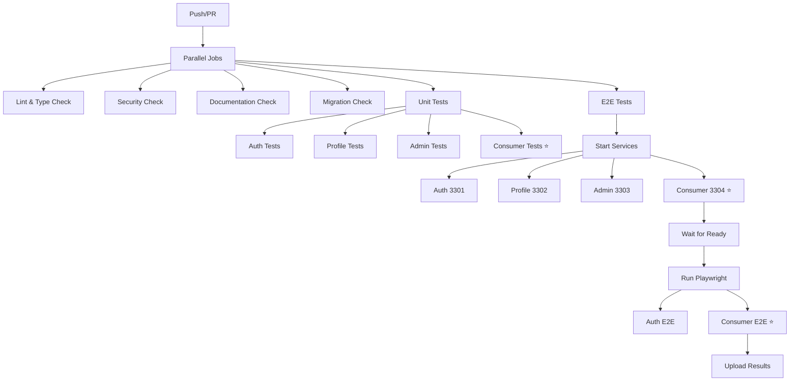

# CI/CD Test Coverage

This document describes the automated tests that run on every push and pull request.

## GitHub Actions Workflow

**Workflow File**: `.github/workflows/test.yml`

### Test Jobs

The test suite runs 6 parallel jobs:

#### 1. Lint and Type Check ✅
- TypeScript type checking for all apps
- Auth app deployment dry-run validation
- **Includes**: Audit consumer type checking

#### 2. Security Check 🔒
- Dependency vulnerability scanning (`pnpm audit`)
- Hardcoded secrets detection (regex scan)
- Production dependencies only

#### 3. Documentation Check 📚
- Verifies required documentation exists:
  - `README.md`
  - `USER_MANAGEMENT.md`
  - `CICD.md`

#### 4. Migration Check 🗄️
- Validates SQL migration files
- Basic SQL syntax checking
- Migration file completeness

#### 5. Unit Tests 🧪
**Apps Tested**:
- ✅ Auth server (`apps/auth`)
- ✅ Profile app (`apps/profile`)
- ✅ Admin dashboard (`apps/admin`)
- ✅ **Audit consumer** (`apps/audit-consumer`) ⭐ NEW

**Tests Run**:
```bash
pnpm test  # Runs all apps' unit tests
```

**Coverage Reports**: Uploaded as artifacts (retained 30 days)

#### 6. E2E Tests 🎭
**Services Started** (ports 3301-3304):
- ✅ Auth server (3301) - OpenAuth with enterprise features
- ✅ Profile app (3302) - User-facing profile management
- ✅ Admin dashboard (3303) - Admin UI
- ✅ **Audit consumer (3304)** - Queue worker ⭐ NEW

**Test Suites**:
1. **Auth Flow Tests** (`e2e/tests/`)
   - User registration
   - Login/logout
   - OAuth flows
   - RBAC (Role-Based Access Control)
   - Admin operations

2. **Audit Consumer Tests** (`e2e/audit-consumer/`) ⭐ NEW
   - Consumer health checks
   - Queue message processing
   - Batch processing (up to 50 events)
   - Token operation auditing (generate, refresh, revoke, reuse)
   - Error handling and retries
   - Performance benchmarks
   - OAuth integration (introspection, revocation)

**Test Output**: Uploaded as artifacts (retained 30 days)
- HTML report (`e2e-report/`)
- JSON results (`e2e-results.json`)
- JUnit XML (`e2e-results.xml`)
- Test videos (on failure, retained 7 days)

## New Audit Consumer Tests ⭐

### Unit Tests (Vitest)
**File**: `apps/audit-consumer/src/index.test.ts`

- Queue handler tests (12+ test cases)
- HTTP endpoints (health, metrics)
- All event types (generated, refreshed, revoked, reused)
- Batch processing (1-50 messages)
- Error scenarios

**Run Locally**:
```bash
pnpm --filter audit-consumer test
```

### E2E Tests (Playwright)
**File**: `e2e/audit-consumer/audit-consumer.spec.ts`

- Consumer health & metrics (2 tests)
- Queue-based audit logging (2 tests)
- Token operations (2 tests)
- Error handling (2 tests)
- Performance metrics (2 tests)
- OAuth integration (3 tests)

**Total**: 15+ E2E test cases

**Run Locally**:
```bash
npx playwright test e2e/audit-consumer
```

## CI Ports Configuration

| Service          | Port | Endpoint                     |
|------------------|------|------------------------------|
| Auth Server      | 3301 | http://localhost:3301        |
| Profile App      | 3302 | http://localhost:3302        |
| Admin Dashboard  | 3303 | http://localhost:3303        |
| Audit Consumer   | 3304 | http://localhost:3304/health |

## Test Execution Flow



## Test Coverage Summary

### Before (Old Setup)
- ✅ 3 apps with tests
- ✅ E2E for auth flows only
- ❌ No audit logging tests

### After (Current Setup) ⭐
- ✅ **4 apps with tests** (added consumer)
- ✅ E2E for auth flows
- ✅ **E2E for audit consumer**
- ✅ **Queue-based processing tests**
- ✅ **15+ new test cases**
- ✅ **Unit tests for consumer worker**

## CI Checks Status

All checks must pass before merge:
- ✅ Lint and Type Check
- ✅ Security Check
- ✅ Documentation Check
- ✅ Migration Check
- ✅ Unit Tests (all 4 apps)
- ✅ E2E Tests (auth + **audit consumer**)

## Local Testing

### Run All Tests
```bash
# Unit tests
pnpm test

# E2E tests
pnpm test:e2e

# Specific suite
pnpm --filter audit-consumer test
npx playwright test e2e/audit-consumer
```

### Watch Mode
```bash
# Unit tests
pnpm --filter audit-consumer test:watch

# E2E tests
pnpm test:e2e:ui
```

## Artifacts

### Coverage Reports (30 days)
- `apps/*/coverage/`

### E2E Results (30 days)
- `e2e-report/index.html` - HTML report
- `e2e-results.json` - JSON results
- `e2e-results.xml` - JUnit XML

### Test Videos (7 days, on failure)
- `test-results/**/*.webm`

## Performance Benchmarks

Expected CI performance:
- **Unit tests**: < 30 seconds (all apps)
- **E2E tests**: < 5 minutes (all suites)
- **Total CI time**: < 10 minutes

## Related Documentation

- [E2E Audit Consumer Tests README](./e2e/audit-consumer/README.md)
- [Audit Consumer README](./apps/audit-consumer/README.md)
- [CI/CD Guide](./CICD.md)
